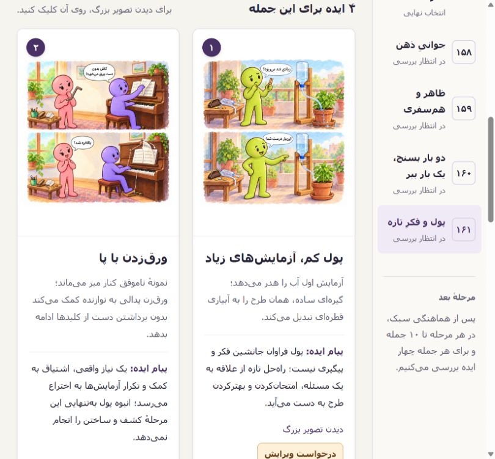
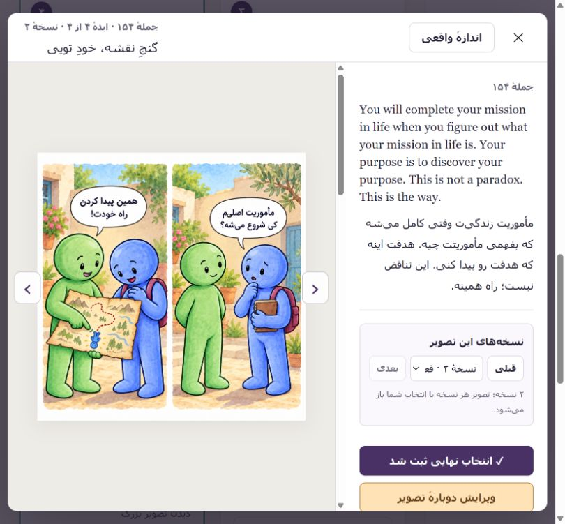

# Excellent Advice — کارگاه تصویرسازی کتاب

A Persian, right-to-left review studio for a 460-sentence illustrated book. Each original image is linked to its complete English generation prompt, feedback, revision history and final Excel entry.

**Private repository:** [zuziai/excellent-advice-studio](https://github.com/zuziai/excellent-advice-studio). GitHub access is required to clone it. [TRANSFER.json](TRANSFER.json) records the included snapshot and validation results.

[شروع سریع فارسی](#شروع-سریع-فارسی) · [English setup](#english-setup) · [Review workflow](#review-workflow) · [Files](#files-and-data-contracts) · [Verification](#verification) · [Troubleshooting](#troubleshooting) · [Reproduction](#reproduction-and-scope)



## شروع سریع فارسی

1. مخزن را clone کنید یا ZIP آن را از GitHub بگیرید؛ ساختار پوشه‌ها را حفظ کنید.
2. پوشهٔ ریشه را در Codex باز کنید؛ ابتدا [AGENTS.md](AGENTS.md) و [راهنمای سبک](review-data/style-contract.md) را بخوانید.
3. با Python نصب‌شده اجرا کنید:

   ```sh
   python setup.py --check
   python setup.py
   ```

   دستور اول وابستگی‌ها را بررسی می‌کند؛ دومی به کتابخانه‌های **از قبل نصب‌شده** پیوند می‌زند. هیچ‌کدام بسته‌ای دانلود نمی‌کنند. در ویندوز می‌توانید به‌جای `python` از `py -3` یا مسیر Python محیط Codex استفاده کنید.
4. در ویندوز [Open Book Review.cmd](Open%20Book%20Review.cmd) را اجرا کنید. روش مستقیم در همهٔ سیستم‌ها:

   ```sh
   python book-review/server.py
   ```

5. [http://127.0.0.1:8765/](http://127.0.0.1:8765/) را باز کنید. ترمینالِ اجرای مستقیم باید باز بماند؛ فایل CMD در ویندوز سرور را مستقل و پنهان اجرا می‌کند.

برای نمایش تصاویر فقط Python لازم است. **ثبت پرامپت در اکسل** به Node و `@oai/artifact-tool` محیط Codex نیز نیاز دارد. هنگام ثبت نهایی اکسل را ببندید. ثبت نظر به معنی موفقیت ذخیرهٔ نهایی نیست؛ منتظر پیام «ذخیرهٔ نهایی کامل شد» بمانید.

## English setup

From a terminal authorized for this private repository:

```sh
git clone https://github.com/zuziai/excellent-advice-studio.git
cd excellent-advice-studio
python setup.py --check
python setup.py
python book-review/server.py
```

Open **http://127.0.0.1:8765/**. This is a local application; keep its server running. If another clone owns port 8765, stop that server first. The Windows launcher deliberately reuses an existing server on that port.

### Dependencies

| Component | Required for | Verified environment |
| --- | --- | --- |
| Python 3.10+ | Server, feedback and version history | Python 3.12.14 |
| Node.js | Excel prompt writer | Node v24.19.0 |
| Installed `@oai/artifact-tool` | Spreadsheet authoring | Version 2.8.94 from Codex workspace dependencies |
| Git and GitHub authentication | Clone and push | Owner `zuziai`, official Git credential flow |
| Codex built-in image tool | Generating/editing artwork | Used through Codex; no API key is bundled |

The UI uses local JS/CSS and system fonts: no frontend build, npm install, external font or CDN is needed. The server and fixture tests use Python's standard library. Spreadsheet dependencies and machine runtimes are not vendored.

`setup.py --check` is read-only. `setup.py` links an existing dependency installation with a Windows junction or symlink; it never replaces an existing directory or downloads packages. Discovery uses the current user's Codex runtime and PATH, rather than the original author's username or drive.

If discovery fails, set these variables in the terminal that starts the server:

```powershell
$env:CODEX_PYTHON = 'C:\path\to\python.exe'
$env:CODEX_NODE = 'C:\path\to\node.exe'
$env:CODEX_NODE_MODULES = 'C:\path\to\node_modules'
python setup.py --check
python setup.py
python book-review/server.py
```

`CODEX_NODE_MODULES` must contain `@oai/artifact-tool/package.json`. In Codex, use its workspace dependency loader to locate the installed packages. A Python-only machine can view images and save feedback, but Excel finalization needs the spreadsheet runtime. Windows is the tested desktop platform; the foreground Python launcher also supports other platforms, whose full desktop integration has not been independently tested.

## Review workflow

1. Read the English sentence, Persian translation and Persian idea explanation; click an image to enlarge it.
2. Leave a comment and submit **Request edit**. Tell Codex in the chat after submitting. The site records the request; **it does not run an image generator or an autonomous overnight worker**. Codex reads the exact source version and request, edits through its image tool, inspects the actual result and publishes a new version.
3. The spinner represents work explicitly reported as started. A completed edit returns to review and is never automatically approved.
4. **Final selection** explicitly approves the current candidate. The server writes its complete English prompt to Excel column D, verifies that save, then copies the exact original PNG to `Images/{sentenceId}.png`. The browser downloads that same version once after success. Reopening the page does not download again.
5. Wait for **ذخیرهٔ نهایی کامل شد**. If saving fails, the feedback remains; resolve the error and use the retry control.

Decisions are stored in `review-data/feedback.json`. **Download feedback** exports a backup; the local server already has the decisions. Send the JSON to Codex only if it cannot access that same folder. Whole-sentence controls can request edits to all ideas, reject all ideas, or request exactly five variants of an owner-supplied idea; production still occurs through Codex.

### Previous versions and shortcuts

In the enlarged viewer, **نسخه‌های این تصویر**, **قبلی / بعدی** and **بازگشت به نسخهٔ فعلی** browse that idea's actual parent chain. A five-version chain can display all five. The image, download, story and prompt always follow the displayed version. Browsing never changes approval.

Previous versions are read-only in the viewer; return to the current version to approve or edit. Unpublished drafts are not listed as new current alternatives. Missing or corrupt ancestors produce an incomplete-history result instead of invented versions.



| Key | Action |
| --- | --- |
| Left / right arrows | Previous / next idea |
| Up / down arrows | Previous / next sentence |
| `[` / `]` | Previous / next version |
| `1`–`4` (or `5` where available) | Open an idea |
| `F` | Focus feedback for the current version |
| Esc | Close enlarged view |

Shortcuts do not intercept typing in text fields or the version selector.

## Files and data contracts

| Path | Purpose |
| --- | --- |
| `Excellent-Advice-460-FA.xlsx` | Source workbook, worksheet `ترجمه‌ها`, sentence IDs 1–460 |
| `review-data/sentences.json` | Text, row mapping and current workbook SHA-256 |
| `book-review/dist/wave.json` | Active gallery with unique candidate IDs and hashes |
| `book-review/dist/art/` | Published original PNGs with immutable versioned names |
| `review-data/waves/` | Published-wave snapshots for history lookup |
| `review-data/**/{candidateId}.metadata.json` | Image/prompt hashes, full English prompt and provenance |
| `review-data/**/*.full-generation.en.txt` | Complete reusable prompts; edit instructions are separate |
| `review-data/feedback.json` | Decisions, comments and request history |
| `review-data/finalization-state.json` | Verified final saves and Excel row/column evidence |
| `review-data/project-state.json` | Active wave and approval history |
| `Images/` | Exact owner-approved originals named by sentence ID |
| `book-review/finalization.py` | Guarded, idempotent finalization |
| `review-data/save-approved-prompts.mjs` | Workbook writer and prompt verification |
| `book-review/version_history.py` | Verified, read-only image ancestry |
| `AGENTS.md` | Instructions for continuing in Codex |
| `FILES.sha256` | Checksums of the committed transfer snapshot |

**Excel columns:** A = ID; B = English; C = Persian; **D = complete English image prompt**. Find rows by ID, not an assumed offset. English prompts include the exact required Persian in-image text. A short edit instruction is not a reusable full prompt. Excel compacts paragraph whitespace without dropping prompt words; source and cell-display hashes are tracked separately.

Preserve translations, workbook formatting, exact image bytes and approvals. Revising an approved image creates a pending version. Only another explicit approval replaces the final. Successful saves are idempotent; replacement saves preserve local backups and approval history.

## Verification

Run from the repository root. These tests use isolated fixtures and a stub workbook writer; they never approve real artwork or change the source workbook:

```sh
python -m unittest discover -s tests -p "test_*.py" -v
python -m unittest discover -s book-review/tests -p "test_*.py" -v
node --check book-review/dist/app.js
node --check review-data/save-approved-prompts.mjs
python setup.py --check
python verify_snapshot.py
```

Finalization tests cover explicit approval, original bytes, full prompts, retry/idempotence and preservation of decisions. History tests cover five versions, linked legacy ancestors, missing/corrupt files, cycles, unknown IDs and HTTP validation. Fixtures do not replace a dependency check or browser inspection.

With the server running, these read-only endpoints provide direct evidence:

```text
http://127.0.0.1:8765/wave.json
http://127.0.0.1:8765/api/finalizations
http://127.0.0.1:8765/api/image-history?ideaId=154-d-20261019-v2
```

In the browser, open a revised image, select its older version and confirm that the PNG and download URL change together; return to the current version. Check that new candidates load and have their correct Persian explanation and original download. Never use real owner decisions as test data.

`verify_snapshot.py` checks snapshot file hashes, workbook/source agreement, current PNGs and complete prompt hashes without extra packages. Legitimate new feedback or approved saves change state/workbook checksums: regenerate the transfer checksum manifest before the next snapshot commit. A later intentional edit does not invalidate what the earlier commit contained.

## Troubleshooting

| Symptom | Action |
| --- | --- |
| Local page will not connect | Start the server; check which project owns port 8765. |
| Old UI after an update | Refresh. This loads local files and does not regenerate artwork. |
| Missing image | Keep the full clone structure; check the manifest's exact `dist/art` file and hash. |
| Edit remains queued | Tell Codex in chat; the button records a request only. |
| Excel save pending | Close Excel, run `setup.py --check`, resolve dependencies, then retry in the viewer. |
| No previous versions | First versions have no ancestors; check the explicit parent link and ancestor file for edits. |
| GitHub permission denied | Use an account authorized for this private repo. Browser and Git command authentication are separate. |

Traffic to `127.0.0.1` is local. Image generation and GitHub transfers use the internet. Keep large original archives and machine dependencies out of routine transfers.

## Reproduction and scope

The committed source, workbook, exact included PNGs, prompts, feedback and hashes let another authorized person clone and review the **same saved artwork**. Full prompts and reference/edit provenance support further generation. AI image generation is not pixel-deterministic: rerunning a prompt does not guarantee identical pixels. Use the included original PNG and SHA-256 when exact reproduction matters.

Recorded execution steps (`*.executed-steps.json`) and exact edit prompt files accompany the standalone final generation prompts. Historical input paths can refer to unpublished working drafts retained on the author's machine; the manifests identify the originals included in this clone. Earlier calls without a saved execution transcript are not reconstructed as if they were recorded.

The original style references **131 and 148** are included as `Images/131.jpg` and `Images/148.jpg`; `ARTWORKS.json` records their hashes. Approved final illustrations use PNG filenames.

Not bundled: the full original image 1–150 reference archive (about 1.5 GB), source Word/PDF, local workbook backups, raw image-tool responses, old Git history, machine runtimes, `node_modules`, credentials, session tokens and locks. Included artwork is listed in `TRANSFER.json` and `ARTWORKS.json`; another historical provenance path does not prove that reference is bundled. Obtain the separate reference archive from the owner if a later task requires it.

Keep the repository private under **zuziai**. Do not commit credentials, runtime requirements tied to a particular username/drive, dependency junctions, raw generation payloads or large original archives. No GitHub token or image API key belongs in this repository.
